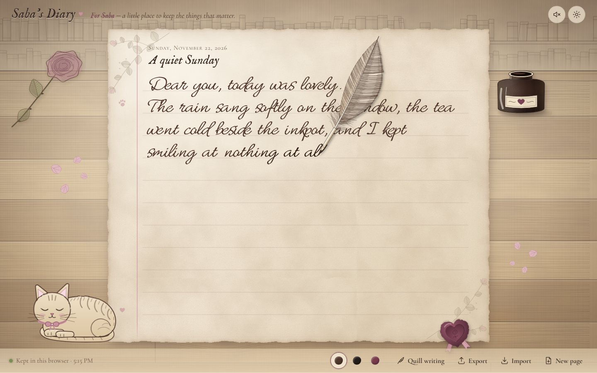
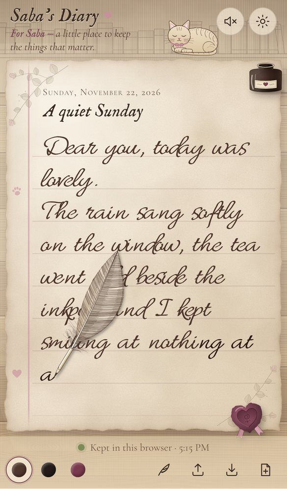

# Saba's Diary

*Every thought deserves to be written beautifully.*

A private, single-page diary that feels like an antique scholar's writing desk: aged parchment, an engraved feather quill, an inkpot, a pressed rose, a burgundy wax seal and a small sleeping cat with a dusty-pink ribbon. Type normally and the quill **writes your words stroke by stroke in real ink** — its nib follows the exact path of every letter.

**Live site:** https://sheikhrobinemon-usf.github.io/Saba-sdiary/

| Desktop | Phone |
|---|---|
|  |  |

---

## What it does

- **Live handwriting.** The `<textarea>` is the real, accessible editor; a stroke engine draws each grapheme with pen strokes in natural writing order beneath a moving quill. Typing, selection, paste, undo/redo, deletion, line breaks and mobile IME composition all work normally.
- **Quill behaviour.** Travels lifted between words, writes with the nib on the paper, lifts at the end of each stroke, returns to the next line on Enter or wrap, rests in the margin when you pause, and now and then dips into the inkpot (after ~80–150 letters and a short idle). Typing interrupts the dip at once.
- **Never loses text.** The animation only mirrors the editor. Fast typing speeds the pen up; past ~500 ms of lag (or on a large paste) older letters are finished instantly and only a short tail is animated. Edits in the middle, undo/redo and resizes reconcile instantly.
- **Saves locally**, automatically (debounced ~300 ms, flushed on blur/page hide) into one versioned LocalStorage document. Reloads restore text, title and settings immediately — no replay.
- **Exports:** *Save as PDF* (print dialog, paginated, handwriting font, parchment background, title/date/dedication), plain text (exact text), and a versioned JSON backup that can be imported again after validation and confirmation.
- **Ink colours:** sepia, iron-gall black, burgundy rose — recolours existing writing; fresh ink dries from a wet tone.
- **Romance & cat:** dedication in the masthead, a pressed rose and petals, a paw print and heart in the margin, a heart-shaped wax seal that opens a hidden note, and a cat that wakes, blinks, stretches and settles when tapped (tail drifts now and then).
- **Respectful by default:** sound is off until you turn it on; reduced-motion users get instant ink; everything can be muted or calmed.

## Privacy

There is no backend, account, analytics or AI service. Nothing you write leaves the browser unless you export it yourself. LocalStorage belongs to this browser on this device: clearing site data or using a private window removes it, so download a backup now and then (**Export → Backup**). The automated tests assert that no network request carries diary content.

## Personalising the gift

Edit **`src/config/journalConfig.ts`** — app name, recipient name (optional), dedication, placeholders, the sealed love note (or disable it), storage key and export file names. No engine or component changes are needed.

## Commands

```bash
npm install          # install dependencies
npm run dev          # local dev server at http://localhost:5173
npm test             # unit tests (Vitest)
npm run build        # type-check + production build into dist/
npm run preview      # serve the production build
npm run test:e2e     # browser acceptance tests (Playwright, Chromium)
npm run gen:font     # rebuild handwriting data + Scribe Hand font from vendor/ems-allure
npm run gen:art      # regenerate the engraved SVG artwork
```

The production build is fully static, uses relative paths, and needs no keys. Pushing to `main` runs unit + browser tests and deploys `dist/` to GitHub Pages (`.github/workflows/deploy.yml`).

## How the handwriting engine works

`src/handwriting/handwritingEngine.ts`

1. **Canonical input.** A real `<textarea>` (transparent text, visible caret) holds the text. The engine never reads text back from the ink.
2. **Exact layout.** A hidden *mirror* element with identical typography lays out the same text in **Scribe Hand**, a companion font generated from the stroke data whose advance widths equal the strokes' widths. The browser's own line breaking therefore decides where every grapheme goes; the engine measures each grapheme with DOM `Range` rects and calibrates the baseline in place (so sub-pixel snapping matches the caret). In tests the ink and the textarea's own glyphs overlap pixel-for-pixel.
3. **Strokes.** Each grapheme is drawn from single-line pen strokes (EMS Allure, SIL OFL — see below), corrected to natural pen direction and smoothed into Béziers. A calligraphic nib is simulated by three offset copies of every stroke, so down-strokes are fuller than hairlines.
4. **Drawing & nib tracking.** Strokes are revealed with `stroke-dashoffset` in a `requestAnimationFrame` loop; the quill's anchor is the exact nib tip and its position comes from `getPointAtLength` on the same path at the same progress, transformed into scene coordinates. Tilt follows the tangent through a low-pass filter.
5. **Edits.** An input diff (disambiguated by the caret) updates only the affected graphemes; later paragraphs are shifted rather than re-measured. Anything other than typing after the current ink — deletes, mid-text edits, undo/redo — reconciles instantly. IME text is shown provisionally (faint) and written once on commit.
6. **State machine:** `resting → travel → writing ⇄ lift → … → resting`, plus `dipping` and `reconcile`, exposed as `data-quill` on the ink layer.
7. **Unsupported characters** (emoji, CJK, …) stay editable and visible as typeset text in the same position, laid out by the same fallback font chain as the editor.

Finished letters collapse into a single `<use>` of a shared glyph definition, so long diaries stay light.

**Why not Tegaki?** Tegaki (MIT) was evaluated: it renders handwriting beautifully but owns its own text layout, so it cannot be kept glyph-for-glyph aligned with a live, editable, wrapping textarea and caret; its EMS Allure bundle also keeps the plotter's reversed stroke order (e.g. `a`), and the package is ~76 MB. A small custom engine on the same single-line font fit the requirements better.

## Accessibility

Real form controls with visible focus, a skip link to the page, named buttons (icon-only buttons have labels), radio-group ink selector, native `<dialog>` modals, keyboard navigation in menus, polite save-status announcements, reduced-motion support and sufficient contrast. Decorative layers are `aria-hidden` and never intercept pointer input; screen readers read the textarea itself.

## Tests

- **Unit (Vitest, 18 tests):** text diff (incl. randomized round-trips and surrogate pairs), grapheme segmentation, glyph coverage and stroke data, document/backup validation and sanitising, preferences.
- **Browser (Playwright, Chromium, 25 tests):** acceptance tests A01–A12 + A14 — nib tracking during writing, exact text after fast typing / 1,000+ character paste / mid-text edits / undo / redo, line returns without connecting ink, resize while writing, phone layout, IME composition, reload without replay, storage-full and corrupt-data handling, exact `.txt`/`.json` exports, paginated print/PDF, validated import with confirmation, new-page confirmation with backup, cross-tab conflict, cat & wax seal, sound opt-in and mute, reduced motion, keyboard-only use and accessible names, no network leakage, and screenshots at 360/390/768/1024/1440 px with overflow checks. Every writing test ends with an engine **audit** that re-measures the layout and checks each grapheme has exactly one correctly placed glyph.

Only Chromium is automated here; Safari/Firefox and real mobile keyboards should be spot-checked by hand.

## Project layout

```
src/
  App.tsx                    composition, dialogs, exports, preferences
  config/journalConfig.ts    personal content (name, dedication, love note)
  handwriting/               engine, glyph data, diff, graphemes
  components/                DeskScene, NotebookEditor, Quill, Inkpot, CatCompanion,
                             WaxSeal, Dedication, Toolbar, Modal, PrintSheet, Icons
  hooks/useJournalStorage.ts versioned LocalStorage document
  lib/                       exportJournal, journalDocument, preferences, sound
  assets/art/                generated engraved SVG artwork
  assets/fonts/              Scribe Hand (generated, OFL)
scripts/                     font and artwork generators
vendor/ems-allure/           source stroke font + licence
tests/unit, tests/e2e        Vitest and Playwright suites
```

## Credits & licences

- Code: MIT (see `LICENSE`).
- Handwriting strokes: **EMS Allure** by Sheldon B. Michaels (single-line derivative of *Allura* by Rob Leuschke, TypeSETit), SVG conversion by Windell H. Oskay — **SIL Open Font License 1.1** (`vendor/ems-allure/OFL.txt`). The derived *Scribe Hand* font and stroke data are distributed under the same licence.
- **Cormorant Garamond** and **IM Fell English** — SIL OFL 1.1, bundled locally via Fontsource.
- All artwork (quill, inkpot, desk and library, rose, petals, botanicals, wax seal, cat, icons) is original, generated from code in this repository. Sounds are synthesised in the browser; there are no audio files.

## Scope notes

Implemented: all P0 requirements and the P1 items (inkpot dipping, dust-in-lamplight ambience, ink drying, wax-seal note). Deliberately not included: multiple sheets per notebook (one sheet scrolls without limit), per-passage ink colours (ink is global, as allowed for v1), and a candle — the warm lamplight and drifting dust stand in for it.
